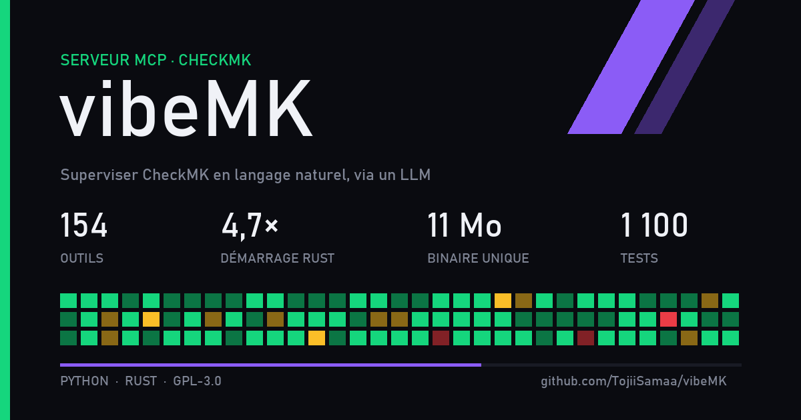

vibeMK est un serveur MCP qui permet de superviser et de configurer CheckMK en langage naturel, depuis un client LLM comme Claude. Il expose 154 outils : état des hôtes et des services, problèmes en cours, temps d'arrêt, acquittements, règles, dossiers et utilisateurs. Il existe en Python et en Rust (démarrage 4,7 fois plus rapide, un binaire de 11 Mo), avec le même catalogue d'outils. Projet sous licence GPL-3.0.
